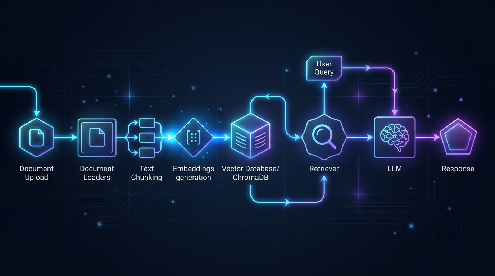
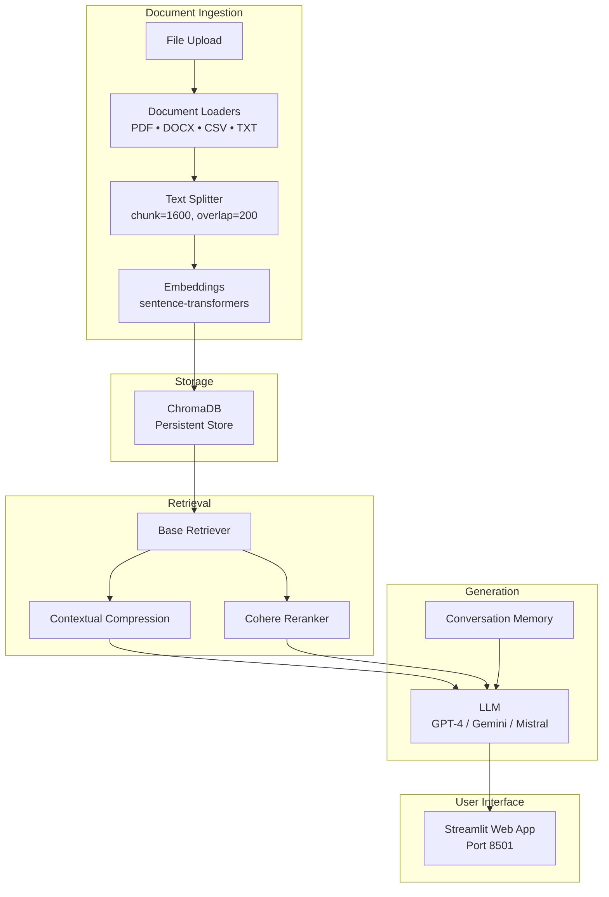
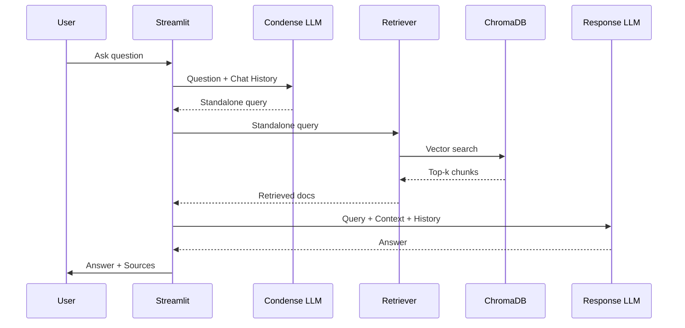

# 🤖 RAG Chatbot — Chat With Your Documents

<div align="center">



**A production-grade Retrieval-Augmented Generation chatbot that answers questions from your PDFs, Word files, CSVs, and text documents.**

[](https://www.python.org/downloads/)
[](https://streamlit.io/)
[](https://langchain.com/)
[](https://www.docker.com/)
[](LICENSE)

[Features](#-features) • [Quick Start](#-quick-start) • [Docker](#-docker) • [Cloud Deploy](#-cloud-deployment) • [Architecture](#-architecture) • [Testing](#-testing)

</div>

---

## 📋 Table of Contents

- [Features](#-features)
- [Quick Start](#-quick-start)
- [Docker](#-docker)
- [Cloud Deployment](#-cloud-deployment)
- [Architecture](#-architecture)
- [Configuration](#-configuration)
- [Testing](#-testing)
- [API Reference](#-api-reference)
- [Contributing](#-contributing)
- [License](#-license)
- [Acknowledgments](#-acknowledgments)

---

## ✨ Features

### Document Support
| Format | Loader | Description |
|--------|--------|-------------|
| 📄 PDF | PyPDFLoader | Multi-page PDF extraction with page tracking |
| 📝 TXT | TextLoader | Plain text files |
| 📊 CSV | CSVLoader | Structured data with UTF-8 encoding |
| 📋 DOCX | Docx2txtLoader | Microsoft Word documents |

### LLM Providers
| Provider | Models | Embedding |
|----------|--------|-----------|
| 🟢 OpenAI | GPT-3.5-Turbo, GPT-4-Turbo | OpenAI Embeddings |
| 🔵 Google | Gemini Pro | Google Generative AI Embeddings |
| 🔴 Groq | openai/gpt-oss-20b, openai/gpt-oss-120b, qwen/qwen3.8-27b | Local HuggingFace Embeddings |
| 🟡 HuggingFace | Mistral-7B-Instruct-v0.2 | HuggingFace Inference API |
| 🟣 Local (Free) | — | sentence-transformers/all-MiniLM-L6-v2 |

### Retrieval Strategies
- **Vectorstore Retriever** — Direct similarity search against ChromaDB
- **Contextual Compression** — Multi-stage pipeline: split → deduplicate → filter → reorder
- **Cohere Reranker** — Neural reranking with `rerank-multilingual-v2.0`

### Production Features
- 🐳 **Docker** — Multi-stage build with health checks
- ☁️ **Cloud Ready** — Google Cloud Run deployment script
- 🧪 **Tested** — Full pytest suite with 7 test modules
- 🌍 **Multilingual** — 10 languages supported for assistant responses
- 💬 **Conversational** — Follow-up questions with memory
- 📑 **Source Citations** — Every answer shows source documents

---

## 🚀 Quick Start

### Prerequisites

- Python 3.11+
- API key for at least one LLM provider (Groq, OpenAI, Google, or HuggingFace)

### 1. Clone the Repository

```bash
git clone <your-repo-url> rag-chatbot
cd rag-chatbot
```

### 2. Create Virtual Environment

```bash
python -m venv venv

# Windows
.\venv\Scripts\activate

# macOS/Linux
source venv/bin/activate
```

### 3. Install Dependencies

```bash
pip install -r requirements.txt
```

### 4. Launch the App

```bash
streamlit run src/app.py
```

The app will open at **http://localhost:8501** 🎉

### 5. Upload & Chat

1. In the sidebar, select your LLM provider and enter your API key
2. Upload documents (PDF, TXT, DOCX, or CSV)
3. Enter a name and click **Create Vectorstore**
4. Start chatting with your documents!

---

## 🐳 Docker

### Build & Run with Docker Compose

```bash
# Build and start
docker-compose up --build

# Run in detached mode
docker-compose up -d --build
```

Access the app at **http://localhost:8501**

### Build & Run Manually

```bash
# Build the image
docker build -t rag-chatbot .

# Run the container
docker run -p 8501:8501 \
  -v $(pwd)/data/vector_stores:/app/data/vector_stores \
  rag-chatbot
```

### Environment Variables (Optional)

Copy `.env.example` to `.env` and fill in your API keys:

```bash
cp .env.example .env
```

```env
GROQ_API_KEY=gsk_...
OPENAI_API_KEY=sk-...
GOOGLE_API_KEY=AI...
COHERE_API_KEY=...
HF_API_KEY=hf_...
```

> **Note**: API keys can also be entered via the Streamlit sidebar at runtime.

---

## ☁️ Cloud Deployment

### Google Cloud Run

#### Prerequisites

1. [Google Cloud SDK](https://cloud.google.com/sdk/docs/install) installed
2. Docker installed
3. A GCP project with billing enabled

#### Deploy

```bash
# Make the script executable
chmod +x scripts/deploy.sh

# Deploy (replace with your project ID)
./scripts/deploy.sh YOUR_PROJECT_ID us-central1 rag-chatbot
```

The script will:
1. Set the GCP project
2. Enable required APIs (Cloud Run, Artifact Registry, Cloud Build)
3. Create an Artifact Registry repository
4. Build and push the Docker image
5. Deploy to Cloud Run with 2Gi memory, 2 vCPUs

After deployment, you'll get a public URL like:
```
https://rag-chatbot-xxxxx-uc.a.run.app
```

#### Resource Configuration

| Setting | Value | Adjustable |
|---------|-------|------------|
| Memory | 2Gi | `--memory` flag |
| CPUs | 2 | `--cpu` flag |
| Min instances | 0 | `--min-instances` flag |
| Max instances | 3 | `--max-instances` flag |
| Port | 8501 | `--port` flag |

---

## 🏗️ Architecture

### System Overview



### Query Processing Flow



### Project Structure

```
rag-chatbot/
├── src/                         # Application source (9 modules)
│   ├── app.py                   # Streamlit UI entry point
│   ├── config.py                # Configuration & constants
│   ├── document_loader.py       # Multi-format document loading
│   ├── text_splitter.py         # Document chunking
│   ├── embeddings.py            # Embedding model selection
│   ├── vector_store.py          # ChromaDB operations
│   ├── retriever.py             # Retriever factory
│   ├── chain.py                 # ConversationalRetrievalChain
│   └── memory.py                # Conversation memory
├── tests/                       # Automated test suite (7 modules)
├── data/                        # Runtime data
│   ├── sample_docs/             # Sample documents
│   ├── tmp/                     # Uploaded file staging
│   └── vector_stores/           # Persisted ChromaDB stores
├── scripts/                     # Deployment scripts
├── docs/                        # Documentation & diagrams
├── Dockerfile                   # Multi-stage Docker build
├── docker-compose.yml           # Local dev orchestration
└── requirements.txt             # Python dependencies
```

For detailed architecture documentation, see [`docs/architecture.md`](docs/architecture.md).

---

## ⚙️ Configuration

### Model Parameters

| Parameter | Default | Range | Description |
|-----------|---------|-------|-------------|
| Temperature | 0.5 | 0.0 – 1.0 | Controls randomness. Lower = more deterministic |
| Top P | 0.95 | 0.0 – 1.0 | Nucleus sampling threshold |

### Chunking Parameters

| Parameter | Default | Description |
|-----------|---------|-------------|
| `chunk_size` | 1600 | Maximum characters per chunk |
| `chunk_overlap` | 200 | Overlap between consecutive chunks |

### Retriever Parameters

| Parameter | Default | Description |
|-----------|---------|-------------|
| `base_retriever_k` | 16 | Number of documents from base retriever |
| `compression_retriever_k` | 20 | Top-k after compression pipeline |
| `cohere_top_n` | 10 | Top-n from Cohere reranker |

---

## 🧪 Testing

### Run All Tests

```bash
# Install dev dependencies
pip install -r requirements-dev.txt

# Run tests
pytest tests/ -v
```

### Run with Coverage

```bash
pytest tests/ -v --cov=src --cov-report=term-missing
```

### Test Modules

| Module | Tests | Description |
|--------|-------|-------------|
| `test_config.py` | 6 | Configuration validation |
| `test_document_loader.py` | 5 | Document loading for each format |
| `test_text_splitter.py` | 5 | Chunking logic & edge cases |
| `test_embeddings.py` | 3 | Embedding model instantiation |
| `test_vector_store.py` | 4 | ChromaDB CRUD operations |
| `test_retriever.py` | 3 | Retriever creation strategies |
| `test_chain.py` | 4 | Prompt templates & chain assembly |

---

## 📚 API Reference

### `src/document_loader`

```python
load_documents(directory: Path) -> list[Document]
save_uploaded_files(uploaded_files, tmp_dir: Path) -> None
delete_temp_files(tmp_dir: Path) -> None
```

### `src/text_splitter`

```python
split_documents(documents: list, chunk_size: int = 1600, chunk_overlap: int = 200) -> list
```

### `src/embeddings`

```python
get_embeddings(provider: str, api_key: str = None) -> Embeddings
# Providers: "OpenAI", "Google", "HuggingFace", "local"
```

### `src/vector_store`

```python
create_vector_store(chunks, embeddings, persist_directory: str) -> Chroma
load_vector_store(embeddings, persist_directory: str) -> Chroma
list_vector_stores(base_dir: Path) -> list[str]
```

### `src/retriever`

```python
create_retriever(vector_store, embeddings, retriever_type: str, **kwargs) -> BaseRetriever
# Types: "Vectorstore backed retriever", "Contextual compression", "Cohere reranker"
```

### `src/chain`

```python
create_chain(retriever, provider, model, api_key, language="english", ...) -> tuple[Chain, Memory]
create_llm(provider, api_key, model, temperature=0.5, top_p=0.95) -> BaseLLM
```

### `src/memory`

```python
create_memory(model_name: str = "gpt-3.5-turbo", openai_api_key: str = None) -> BaseChatMemory
```

---

## 🤝 Contributing

1. Fork the repository
2. Create a feature branch: `git checkout -b feature/amazing-feature`
3. Make your changes
4. Run tests: `pytest tests/ -v`
5. Commit: `git commit -m 'Add amazing feature'`
6. Push: `git push origin feature/amazing-feature`
7. Open a Pull Request

---

## 📄 License

This project is licensed under the MIT License — see the [LICENSE](LICENSE) file for details.

---

## 🙏 Acknowledgments

- Inspired by [AlaGrine/RAG_chatabot_with_Langchain](https://github.com/AlaGrine/RAG_chatabot_with_Langchain)
- Built with [LangChain](https://langchain.com/), [ChromaDB](https://www.trychroma.com/), [Streamlit](https://streamlit.io/)
- Embedding model: [sentence-transformers/all-MiniLM-L6-v2](https://huggingface.co/sentence-transformers/all-MiniLM-L6-v2)
