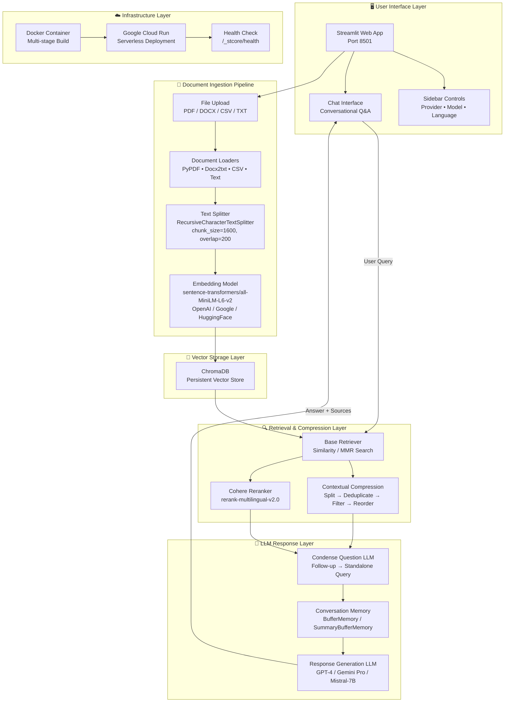
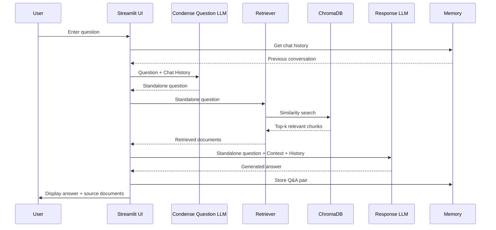
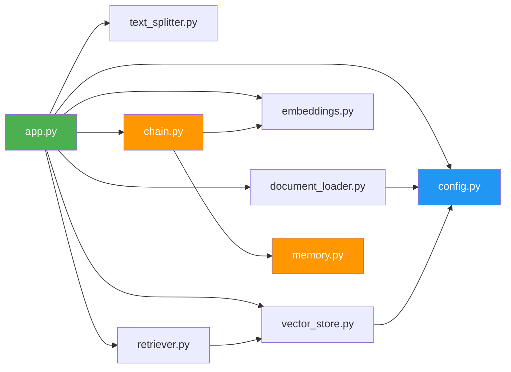
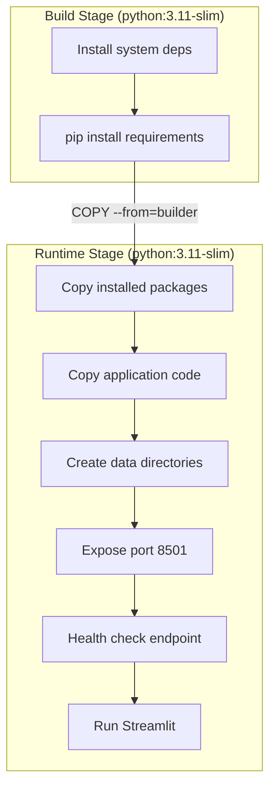

# Architecture Documentation

## System Architecture

## Data Flow: Query Processing

## Module Dependency Graph

## Retriever Strategies

### 1. Vectorstore Backed Retriever (Base)
Simple similarity search against the ChromaDB vector store. Returns top-k most similar document chunks.

### 2. Contextual Compression
A multi-stage pipeline that improves retrieval quality:
1. **CharacterTextSplitter** — Re-split retrieved docs into smaller chunks (500 chars)
2. **EmbeddingsRedundantFilter** — Remove duplicate/near-duplicate chunks
3. **EmbeddingsFilter** — Keep only chunks above relevance threshold
4. **LongContextReorder** — Place most relevant chunks at beginning/end (Lost in the Middle phenomenon)

### 3. Cohere Reranker
Uses Cohere's `rerank-multilingual-v2.0` model to re-score and reorder retrieved documents by relevance. Requires a Cohere API key.

## Docker Architecture

